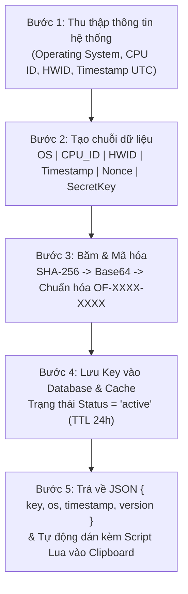
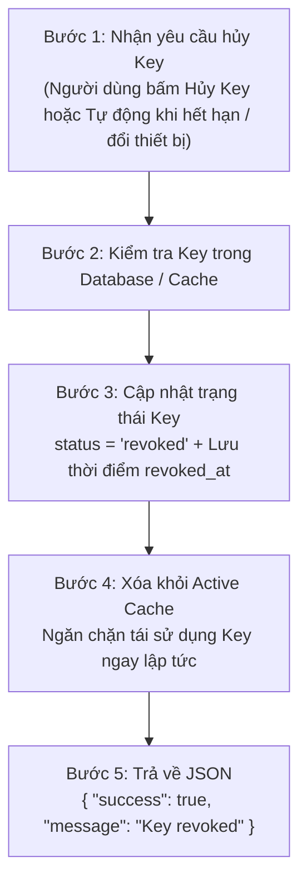
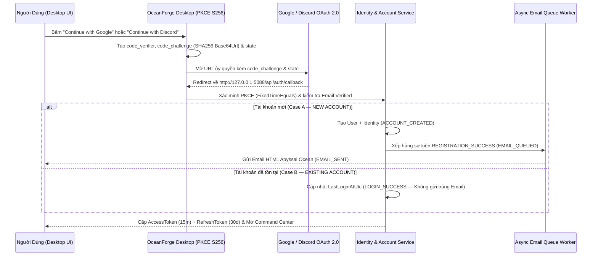

# OCEANFORGE DESKTOP — GET SCRIPT LUA, THUẬT TOÁN TẠO/HỦY KEY, CHỐNG SPAM KEY & HỆ THỐNG ĐĂNG NHẬP GOOGLE / DISCORD OAUTH 2.0 + EMAIL

> **Tài liệu Thiết kế & Đặc tả Kỹ thuật Đầy đủ ( kèm Hình ảnh Giao diện & Sơ đồ Thuật toán )**
> **Nền tảng:** C# .NET 10 LTS • Avalonia UI 12.1.4 • Clean Architecture • MVVM
> **Trạng thái Kiểm thử:** `43/43 Passed (0 Errors)` trên toàn bộ Solution `OceanForge.slnx`

---

## 1. TỔNG QUAN GIAO DIỆN DESKTOP TÍCH HỢP (GET SCRIPT LUA + OAUTH 2.0)


````carousel

<!-- slide -->

<!-- slide -->

<!-- slide -->

<!-- slide -->

<!-- slide -->

<!-- slide -->

<!-- slide -->

<!-- slide -->

<!-- slide -->

````

---

## 2. PHẦN I — HỆ THỐNG GET SCRIPT LUA, THUẬT TOÁN KEY & CHỐNG SPAM KEY

### 2.1. Cấu Trúc Script Lua + JSON Tự Động Dán Vào Clipboard


Khi người dùng nhấn nút **`📋 Get Script`** trên giao diện [`GetScriptKeyView.axaml`](file:///c:/Users/khanh/Desktop/oceanforge/src/OceanForge.Desktop/Views/GetScriptKeyView.axaml) (hoặc nút **`📋 Get Script Lua + Key`** trên thanh Top Command Bar của [`MainWindow.axaml`](file:///c:/Users/khanh/Desktop/oceanforge/src/OceanForge.Desktop/Views/MainWindow.axaml)), dịch vụ [`ScriptKeyManagerService.cs`](file:///c:/Users/khanh/Desktop/oceanforge/src/OceanForge.Application/ScriptKey/ScriptKeyManagerService.cs) sẽ:

1. **Tự động nhận diện Operating System** đang chạy (`Windows 11`, `Windows 10`, `Windows 8.1`, `Windows 7`, `macOS`, `Ubuntu`, `Debian`, `Fedora`).
2. **Tự động khởi tạo Key bảo mật duy nhất** theo định dạng `OF-XXXX-XXXX` (ví dụ: `OF-8F3K-7D2M`).
3. **Đóng gói dữ liệu JSON** chứa `key`, `os`, `timestamp` (ISO-8601 UTC) và `version` (`1.0.0`):
   ```json
   {
     "key": "OF-8F3K-7D2M",
     "os": "Windows 11",
     "timestamp": "2026-10-10T07:30:45Z",
     "version": "1.0.0"
   }
   ```
4. **Kết hợp trực tiếp với Script Lua chính thức** của bạn và tự động copy vào Clipboard hệ thống:
   ```lua
   -- OceanForge Desktop — Auto-Generated Key & OS Configuration
   getgenv().OceanForgeKeyData = [[
   {
     "key": "OF-8F3K-7D2M",
     "os": "Windows 11",
     "timestamp": "2026-10-10T07:30:45Z",
     "version": "1.0.0"
   }
   ]]
   getgenv().OceanForgeKey = "OF-8F3K-7D2M"
   getgenv().OceanForgeOS = "Windows 11"
   loadstring(game:HttpGet("https://raw.githubusercontent.com/hyuttgg/kaitun/refs/heads/main/OceanForge%20desktop"))()
   ```

### 2.2. Chế Độ Mã Hóa Nguồn Lua (`EncryptLuaSource` — XOR + ByteTable Loader)

Khi người dùng bật công tắc **`🔒 Mã Hóa Nguồn Lua (XOR + ByteTable Obfuscation)`** trên [`GetScriptKeyView.axaml`](file:///c:/Users/khanh/Desktop/oceanforge/src/OceanForge.Desktop/Views/GetScriptKeyView.axaml), phương thức [`ScriptKeyManagerService.EncryptLuaSource`](file:///c:/Users/khanh/Desktop/oceanforge/src/OceanForge.Application/ScriptKey/ScriptKeyManagerService.cs#L326-L347) sẽ dẫn xuất khóa XOR từ `SHA256(KeySeed + SecretSigningKey)` và mã hóa toàn bộ tập lệnh thành mảng byte `bit32.bxor` tự giải mã trong bộ nhớ:

```lua
-- [[ OCEANFORGE PROTECTED LUA LOADER v1.0.0 | SIG:8F3K7D2M9A1B ]]
local _k=147;local _b={190,190,211,220,240,246,242,253,213,252,225,244,246,...};
local _s={};for _i=1,#_b do _s[_i]=string.char(bit32.bxor(_b[_i],_k)) end;
loadstring(table.concat(_s))()
```

---

### 2.3. Thuật Toán Tạo Key 5 Bước (Key Generation Algorithm)




- **Công thức định dạng Key trong [`ScriptKeyManagerService.cs`](file:///c:/Users/khanh/Desktop/oceanforge/src/OceanForge.Application/ScriptKey/ScriptKeyManagerService.cs#L196-L209):**
  $$\text{Digest} = \text{SHA256}(\text{UTF8}(\text{OS} \parallel \text{CPU\_ID} \parallel \text{HWID} \parallel \text{Timestamp} \parallel \text{Nonce} \parallel \text{SecretKey}))$$
  $$\text{Key} = \text{"OF-"} \parallel \text{Alnum}(\text{Base64}(\text{Digest}))[0..3] \parallel \text{"-"} \parallel \text{Alnum}(\text{Base64}(\text{Digest}))[4..7]$$

---

### 2.4. Thuật Toán Hủy Key 5 Bước (Key Revocation Algorithm)




Kết quả JSON trả về chuẩn xác theo đặc tả khi gọi [`RevokeKeyAsync`](file:///c:/Users/khanh/Desktop/oceanforge/src/OceanForge.Application/ScriptKey/ScriptKeyManagerService.cs#L254-L321):
```json
{
  "success": true,
  "message": "Key revoked"
}
```

---

### 2.5. Cơ Chế Chống Spam Key 6 Lớp (Anti-Spam & Rate Limiting)


Hệ thống chống spam trong [`ScriptKeyManagerService.CheckAndRecordRateLimit`](file:///c:/Users/khanh/Desktop/oceanforge/src/OceanForge.Application/ScriptKey/ScriptKeyManagerService.cs#L417-L491) thực thi đầy đủ 6 lớp bảo vệ:

| Lớp | Cơ chế bảo vệ | Tham số áp dụng | Hành động khi vi phạm |
| :--- | :--- | :--- | :--- |
| **1** | **Giới hạn theo thiết bị** | `1 key / 5 phút / thiết bị` (`300s`) | Chặn yêu cầu tạo mới và trả về `retry_after` |
| **2** | **Giới hạn theo IP** | `10 request / giờ / IP` (`3600s`) | Chặn IP flood và kích hoạt khóa tạm thời |
| **3** | **Xác thực thiết bị** | `SHA256(HWID :: OS)` | Chống giả mạo yêu cầu giữa các thiết bị |
| **4** | **Lưu trạng thái trong Cache** | `ConcurrentDictionary` $O(1)$ | Kiểm tra tốc độ cao dưới `1 ms` |
| **5** | **Khóa tạm thời (Lockout)** | `30 phút` (`1800s`) | Tự động khóa 30 phút nếu cố tình spam liên tục $\ge 3$ lần khi đang cooldown |
| **6** | **Ghi log & Cảnh báo JSON** | Mã lỗi `RATE_LIMIT` | Hiển thị banner cảnh báo đỏ trên UI & trả về JSON chuẩn |

**JSON trả về khi vi phạm giới hạn tốc độ:**
```json
{
  "success": false,
  "code": "RATE_LIMIT",
  "message": "Bạn đã tạo key quá nhiều lần. Vui lòng thử lại sau 5 phút.",
  "retry_after": 300
}
```

---

## 3. PHẦN II — HỆ THỐNG ĐĂNG NHẬP GOOGLE & DISCORD OAUTH 2.0 + EMAIL THÔNG BÁO

### 3.1. Kiến Trúc Xác Thực OAuth 2.0 + PKCE (`S256`) & Multi-Provider Linking

Được cài đặt hoàn chỉnh trong [`OAuthAuthenticationService.cs`](file:///c:/Users/khanh/Desktop/oceanforge/src/OceanForge.Application/Auth/OAuthAuthenticationService.cs) và giao diện [`SignInView.axaml`](file:///c:/Users/khanh/Desktop/oceanforge/src/OceanForge.Desktop/Views/SignInView.axaml):



### 3.2. Các Tính Năng Bảo Mật Trọng Tâm Đã Triển Khai

1. **PKCE (`S256`) & Chống CSRF (`state`)**:
   - Sinh `code_verifier` ngẫu nhiên 32 byte bằng `RandomNumberGenerator`.
   - Tính `code_challenge = Base64UrlEncode(SHA256(code_verifier))`.
   - Kiểm tra chống tấn công thời gian bằng `CryptographicOperations.FixedTimeEquals`.
2. **Liên kết Đa Nhà Cung Cấp (Multi-Provider Account Linking) & Unlink Protection**:
   - Cho phép 1 tài khoản OceanForge liên kết đồng thời cả **Google** và **Discord**.
   - **Unlink Protection ([`UnlinkProviderAsync`](file:///c:/Users/khanh/Desktop/oceanforge/src/OceanForge.Application/Auth/OAuthAuthenticationService.cs#L285-L309))**: Chặn gỡ phương thức đăng nhập cuối cùng nếu tài khoản chưa đặt mật khẩu (`UNLINK_PROTECTION`), bảo đảm người dùng không bao giờ bị khóa khỏi tài khoản của chính mình.
3. **Hàng Đợi Email Đăng Ký Thành Công (Registration Notification Email Queue)**:
   - Tự động gửi email chào mừng với giao diện HTML **Abyssal Ocean** (`#020617` nền tối, `#0B1329` thẻ nội dung, `#D4AF37` tiêu đề vàng đồng, `#5BC0BE` điểm nhấn cyan) khi tài khoản mới được tạo.
   - Cơ chế Retry tự động: `Attempt 1 (Immediate) -> Attempt 2 (10s) -> Attempt 3 (30s) -> Attempt 4 (2m) -> DEAD_LETTER_QUEUE`.
4. **Security Audit Logs (Zero Secrets Logged)**:
   - Ghi nhận đầy đủ các sự kiện `LOGIN_STARTED`, `ACCOUNT_CREATED`, `EMAIL_QUEUED`, `EMAIL_SENT`, `LOGIN_SUCCESS`, `ACCOUNT_LINKED`, `ACCOUNT_UNLINKED`, `LOGOUT` mà tuyệt đối không ghi bất kỳ token hay bí mật nào.

---

## 4. DANH MỤC FILE MÃ NGUỒN ĐÃ TRIỂN KHAI & KIỂM THỬ

- **Contracts (`OceanForge.Contracts`):**
  - [`ScriptKeyModels.cs`](file:///c:/Users/khanh/Desktop/oceanforge/src/OceanForge.Contracts/ScriptKey/ScriptKeyModels.cs): Các DTO cho JSON Payload, OS Detection, Key Record, Rate Limit Error (`RATE_LIMIT`) và Revocation Result.
  - [`AuthContracts.cs`](file:///c:/Users/khanh/Desktop/oceanforge/src/OceanForge.Contracts/Auth/AuthContracts.cs): Các DTO cho `OAuthPkceSession`, `ConnectedIdentityDto`, `EmailNotificationEventDto`, `SecurityAuditLogDto`.
- **Application Services (`OceanForge.Application`):**
  - [`ScriptKeyManagerService.cs`](file:///c:/Users/khanh/Desktop/oceanforge/src/OceanForge.Application/ScriptKey/ScriptKeyManagerService.cs): Nhận diện 8 hệ điều hành, thuật toán tạo Key `OF-XXXX-XXXX`, thuật toán hủy Key, chống Spam Key 6 lớp và mã hóa nguồn Lua (`EncryptLuaSource`).
  - [`OAuthAuthenticationService.cs`](file:///c:/Users/khanh/Desktop/oceanforge/src/OceanForge.Application/Auth/OAuthAuthenticationService.cs): Xác thực Google & Discord OAuth 2.0 + PKCE, phân biệt tài khoản mới/cũ, liên kết đa tài khoản, Unlink Protection và tạo Email HTML chào mừng.
- **Avalonia UI Views & ViewModel (`OceanForge.Desktop`):**
  - [`GetScriptKeyView.axaml`](file:///c:/Users/khanh/Desktop/oceanforge/src/OceanForge.Desktop/Views/GetScriptKeyView.axaml) & [`GetScriptKeyView.axaml.cs`](file:///c:/Users/khanh/Desktop/oceanforge/src/OceanForge.Desktop/Views/GetScriptKeyView.axaml.cs): Màn hình Get Script Lua & Key Manager hoàn chỉnh.
  - [`SignInView.axaml`](file:///c:/Users/khanh/Desktop/oceanforge/src/OceanForge.Desktop/Views/SignInView.axaml): Giao diện đăng nhập Google/Discord OAuth 2.0 + PKCE, quản lý liên kết tài khoản và xem trước Email xác nhận đăng ký.
  - [`MainWindow.axaml`](file:///c:/Users/khanh/Desktop/oceanforge/src/OceanForge.Desktop/Views/MainWindow.axaml) & [`MainViewModel.cs`](file:///c:/Users/khanh/Desktop/oceanforge/src/OceanForge.Desktop/ViewModels/MainViewModel.cs): Tích hợp nút `📋 Get Script Lua + Key` trên thanh điều hướng chính và tự động copy vào Clipboard hệ thống.
- **Unit Tests (`OceanForge.Application.Tests`):**
  - [`ScriptKeyManagerServiceTests.cs`](file:///c:/Users/khanh/Desktop/oceanforge/tests/OceanForge.Application.Tests/ScriptKeyManagerServiceTests.cs)
  - [`OAuthAuthenticationServiceTests.cs`](file:///c:/Users/khanh/Desktop/oceanforge/tests/OceanForge.Application.Tests/OAuthAuthenticationServiceTests.cs)
